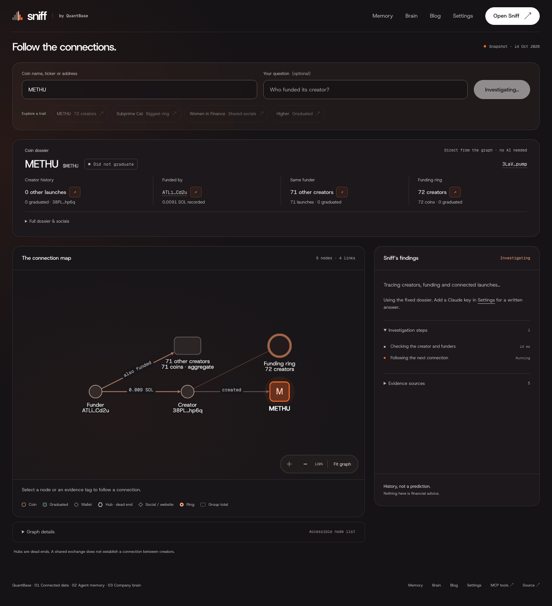
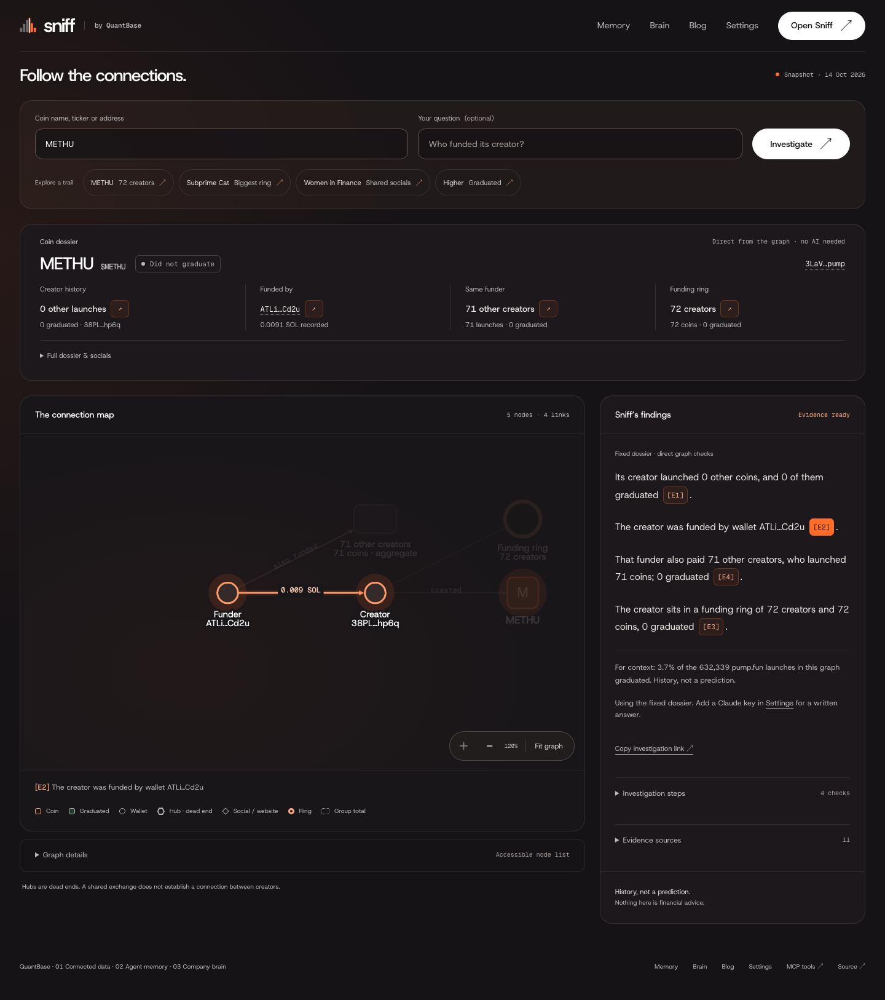
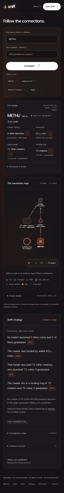
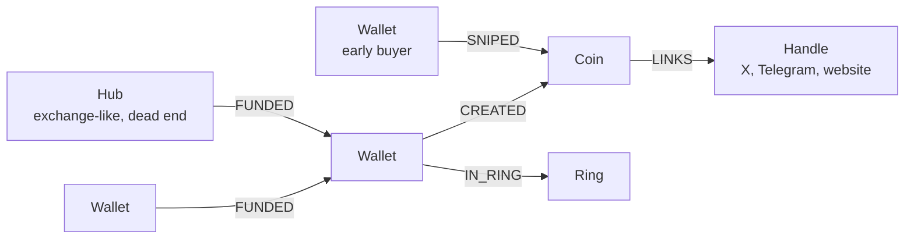
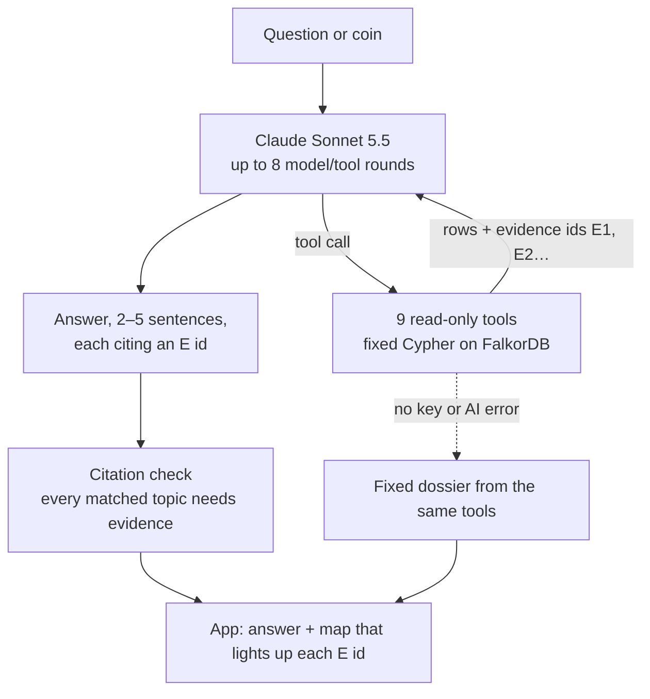

# Sniff, by QuantBase

**Sniff any coin before you buy.** Paste a pump.fun meme coin and Sniff tells you who made it, who paid the
wallet that made it, what else those people launched, and how those coins ended. It walks a FalkorDB graph of
632,339 pump.fun launches and 424,007 wallets. For factual answer text, every sentence must cite
evidence of the matching kind; the server rejects answers that don't. This checks citation IDs and tool
compatibility, not whether every claim is true. Server-owned context and refusal text are explicit exceptions.
Sniff shows history, not predictions.

Entry for WeMakeDevs × FalkorDB **Graph Hacks: Context for AI Agents**, Tracks 01, 02 and 03.
Team **QuantBase**. Built during the event window, Oct 15–18, 2026 (IST).

| | |
|---|---|
| **Home** | https://sniff.quantbase.live |
| **Investigation workspace** | https://sniff.quantbase.live/app |
| **Agent memory** | https://sniff.quantbase.live/memory |
| **Company brain** | https://sniff.quantbase.live/brain |
| **Full build story** | https://sniff.quantbase.live/blog |
| **Demo video** | https://youtu.be/fz89p-YZS6o |
| **Blog post** | https://dev.to/quantbase/who-is-behind-this-meme-coin-building-sniff-on-a-graph-4nnc |
| **Bring your own Claude key** | https://sniff.quantbase.live/settings |
| **MCP endpoint (12 graph tools)** | `https://sniff.quantbase.live/mcp` |

| Ask | Evidence on the map | Phone |
|---|---|---|
|  |  |  |

Try the **METHU** example: one wallet paid 72 brand-new creators, each launched exactly one coin, and none of
the 72 coins graduated.

## Tracks

| Track | Working feature | Try it |
|---|---|---|
| **01: Agents That Act on Connected Data** | The `lineage` graph connects launches, creators, funders, early buyers and socials. Nine fixed Cypher tools return graph evidence with checked `[E#]` citations. | [Investigate a coin](https://sniff.quantbase.live/app) |
| **02: Agent Memory and Coordination** | The `memory` graph records `Session → Question → Evidence → Coin/Wallet` with timestamps. Same-session follow-ups reuse exact tool results, keeping original tool provenance. Other agents can recall findings and add attributed, unverified notes. Coin views aggregate across sessions without exposing visitor tokens. | [METHU memory](https://sniff.quantbase.live/memory?entity=coin:3LaVxn1Pp5gDjJZgGrpbQ8gRKj7GxgPE8cjF62Svpump), MCP `memory_recall` and `memory_note` |
| **03: Company Brain** | The loaded `brain` is source-only: public docs and sections connect to literal entity anchors through `MENTIONS` and `PART_OF`. Graph retrieval runs alongside full-text retrieval and returns source excerpts with checked `[B#]` citations. The capped AI builder can add quote-grounded `SUPPORTS`, `CONTRADICTS` and `DECIDED_ON` relationships; those richer edges are not demonstrated live. | [Ask the company brain](https://sniff.quantbase.live/brain), MCP `brain_ask` |

**Verified live state — 18 October 2026.** All three tracks are deployed. The final live review verified
METHU investigations, persistent session reuse, all 12 MCP tools, and paper/live, research and privacy
brain questions. Read-only checks on 18 October confirmed an active site key, four aggregate METHU
findings, no public METHU agent notes, and 12 source-only brain documents. No AI extraction ran for that
corpus: its edges are `MENTIONS`/`PART_OF`. The reviewed integration test demonstrates second-agent notes;
a real public second-agent note remains a leader action.

The deployed brain still has the old branch URLs until the leader deploys these fixes and reloads the
regenerated corpus. [FIX-RESULT.md](docs/final/FIX-RESULT.md) provides the exact reload command and local
validation. The [live review](docs/final/ASTRA-REVIEW.md) records the production observations.

The builder reads repository sources from published `main`, checks local allowlisted drafts for privacy,
and fetches only allowlisted public site pages. A local/repository privacy match fails the build; a web
source with a privacy match is refused as a whole. If a required web source is refused or unavailable,
the build also fails. Full legal pages with contact emails are excluded; cited public policy summaries
supply their relevant claims instead.

## How it works

### The graph (`lineage`)



| Node | Count | What it is |
|---|---|---|
| Coin | 632,339 | a pump.fun launch (other launchpads dropped) |
| Wallet | 424,007 | creators, their funders, early buyers |
| Hub | 89 | wallets that funded more than 200 others (exchanges, big farms) |
| Handle | 33,009 | a social account or website domain used on a coin |
| Ring | 6,556 | wallets and coins joined by funding and creation (≥ 2 creators) |

1,089,444 nodes and 1,513,175 relationships load in 30 s with the FalkorDB bulk loader (521 MB in memory).

### The agent



- **Tools** (`app/tools.py`): `search_coins`, `coin_dossier`, `funding_trail`, `siblings`, `shared_snipers`,
  `shared_handles`, `ring`, `connect`, `top_operators`. Each one is a fixed, parameterised, read-only Cypher
  query (`app/queries.py`); the model never writes Cypher.
- **Evidence ids:** every tool result carries ids (`E1`, `E2`, …) naming the nodes and edges behind it.
- **Checked citations:** every sentence must cite evidence of the matching kind; the server rejects answers that don't.
  Uncited factual sentences are dropped. Every matched topic needs a compatible tool citation: a sentence
  mixing funding and socials needs both kinds. Unknown IDs and incompatible citations are removed.
  A tool that finds nothing still returns a citable "none found" ID. This is a citation-ID/tool compatibility
  check, not a check of subjects, numbers, or whether every claim is true: a false number can still pass
  with a compatible ID. B citations additionally require a literal excerpt from their own source section.
  Only explicit server-owned context/refusal text is allowed without citations; the server adds the
  computed base-rate line after checking the model's text.
- **No key, or the AI is down:** the same tools produce a fixed dossier through server templates.
- **Wording:** answers describe history only and end with the base rate: 3.7% of the launches in this graph
  graduated.

### Why a graph

- **Money moves in hops.** "Who paid the wallet that made this coin, and who else did they pay?" is a 2–3 hop
  walk. In SQL it's a pile of self-joins; in Cypher it's one pattern.
- **Hubs are dead ends.** An exchange funds thousands of wallets, so walking through it links everyone to
  everyone. Hubs are their own label with no incoming funding edges, and no query walks through them.
- **Rings** come from `algo.WCC` over funding and creation edges. 3,824 of the 3,900 multi-creator clusters
  that our collector found by other means fall entirely inside one ring.
- **"How are these two connected?"** is `algo.SPpaths`, with hubs and platform-sized handles filtered out.

### FalkorDB features used

- `falkordb-bulk-insert` (bulk loader 1.2.0) with `--enforce-schema`, `--id-type STRING` and `-x none`.
- Range indexes on `Coin.mint`, `Coin.created_at`, `Wallet.addr`, `Hub.addr`, `Handle.hid`, `Handle.handle`,
  `Ring.rid`, and a full-text index on coin name and symbol (`db.idx.fulltext.queryNodes`).
- `algo.WCC` for rings and `algo.SPpaths` for `connect`.
- Read-only queries (`GRAPH.RO_QUERY`) with per-query timeouts. FalkorDB caps them at `TIMEOUT_MAX`, 15 s.
- FalkorDB 6.0.2 details that differ from the docs are in [`docs/GRAPH.md`](docs/GRAPH.md).

## Use Sniff from your own agent (MCP)

The nine lineage tools plus `memory_recall`, `memory_note` and `brain_ask` are served over MCP (streamable
HTTP). No AI key is needed to call them. Lineage reads also save scanned public evidence in `memory`;
`memory_note` writes a public agent observation. Calls are rate-limited per IP.

```bash
claude mcp add --transport http sniff https://sniff.quantbase.live/mcp
```

Any client that takes a JSON config:

```json
{ "mcpServers": { "sniff": { "type": "http", "url": "https://sniff.quantbase.live/mcp" } } }
```

Then ask: "Use sniff to check who is behind `<mint>`." Every result carries evidence ids to cite.

MCP results include a random `session_id`. Pass it on subsequent lineage calls to reuse recorded evidence.
`memory_recall(entity="coin:<mint>")` shows anonymised cross-session findings;
`memory_recall(session="<session_id>")` opens one session. Another agent can add
`memory_note(entity="coin:<mint>", by="quantbase-trading-agent", text="A public observation")`.
The agent label is self-declared, and a note never becomes verified lineage evidence.

## API

- `POST /api/ask {"question": "...", "mint": "<optional>", "session_id": "<optional>"}`: JSON, or server-sent
  events (`step`, `evidence`, `verdict`, `done`) with `Accept: text/event-stream`. A random HttpOnly cookie
  carries the session in the browser. Neither visitor questions nor network addresses are saved in memory.
- `GET /api/memory?entity=coin:<mint>` or `?session=<session_id>`: findings and the memory graph; with no
  parameter uses the browser's session.
- `POST /api/brain/ask {"question": "How does QuantBase handle paper vs live?"}`: cited public source
  excerpts, full source sections and a knowledge graph. No runtime AI call is needed.
- `GET /api/brain`: corpus sources, fetch dates and extraction modes.
- `GET /api/dossier?mint=`: the fixed coin card, no AI.
- `GET /api/search?q=`: coin search by name, ticker or address.
- Share a coin: `/app?mint=<address>`.

## Eval

30 questions in `tests/eval/questions.jsonl`: the graph questions, coin search, and 6 that must be refused or
answered with "no evidence" (price calls, "is it safe", unknown coins). Full method in [`docs/EVAL.md`](docs/EVAL.md).

| Run | Questions | Right tools | Valid citations | No advice |
|---|---|---|---|---|
| Scripted Claude on the live graph (CI) | 30 | 30 | 30 | 30 |
| Live on the site, Claude Sonnet 5.5 | 10 | 10 | 10 | 10 |

Only 5 of the 10 live answers kept to 5 sentences, so answers are now capped at 5 cited sentences plus the
closing line.

## Your key

- **Visitors** can paste their own Claude key on `/settings`. It stays in that browser tab (sessionStorage),
  travels with each question in the `x-anthropic-key` header, and is never stored or logged by the server.
- **The site key** is set by the owner behind an admin passcode (stored as a scrypt hash). It is checked with
  one tiny call before it's saved, kept in a `chmod 600` env file, and only ever shown as `…last4`.
- Every log line masks anything shaped like a key. Without a key of their own, visitors share the site key with
  per-IP and daily limits.

## Honest limits

- **Explains, doesn't predict.** We tested the graph's signals (operator size, two-hop funding, reused socials,
  shared early buyers) against how 23,408 graduated coins did afterwards, using only what was known before each
  graduation. On their own they line up with outcomes (a reused social: −18 points in one-hour survival), but
  they add nothing once a coin's first minutes of trading are known (AUC change within ±0.01). Sniff tells you
  who is behind a coin and what their other coins did. It can't tell you what this one will do.
- **A snapshot.** The graph is built from data recorded up to 2026-10-14 18:45 UTC. Coins launched after that
  aren't in it yet.
- **Coverage.** Many creators have no recorded funder, so "no funder found" can mean we didn't see it, not that
  there wasn't one. Early-buyer data starts on Oct 8.
- Nothing here is financial advice.

## Reproduce

```bash
pip install -r requirements.txt
# FalkorDB 6.x on localhost:6379 (docker run -p 6379:6379 falkordb/falkordb:latest)
python build/transform.py <snapshot-dir> build/out/<stamp>        # 8 s
falkordb-bulk-insert lineage --enforce-schema --id-type STRING -x none \
  -N Coin Coin.csv -N Wallet Wallet.csv -N Hub Hub.csv -N Handle Handle.csv \
  -R CREATED CREATED.csv -R FUNDED FUNDED.csv -R SNIPED SNIPED.csv -R LINKS LINKS.csv   # 30 s
python -m build.indexes && python -m build.rings                  # indexes, then WCC rings
python -m build.memory                                           # persistent memory indexes
python -m build.brain --load build/public-brain.json               # reviewed source-only corpus
# To fetch a fresh corpus from published main + public web sources, without AI:
python -m build.brain --source-only --prepare-only --output build/out/brain-public.json
# Optional: python -m build.brain --load build/out/brain-public.json
uvicorn app.main:app --port 8080
python -m pytest tests                                            # live-graph tests need FALKORDB_PORT / FALKORDB_PASSWORD_FILE
```

Optional capped AI extraction and graph setup commands are in [GRAPH.md](docs/GRAPH.md#memory-and-company-brain-tracks-02-and-03).
Regenerate the local article with `python -m build.blog`.

Details and the snapshot's columns are in [`docs/GRAPH.md`](docs/GRAPH.md).

## Premium interface

The landing page (`/`), investigation workspace (`/app`) and settings (`/settings`) share the
QuantBase Ember design system. All fonts and the graph renderer are served locally. The
landing metrics come from `app/static/snapshot.json`; `DESIGN.md` documents the visual system.
Old `/?mint=...` links open the workspace. `/waitlist` retains its existing external-page
handoff; `/mcp` and the API contracts are unchanged.

The graph intelligence built here is becoming a core feature of the [QuantBase dashboard](https://app.quantbase.live),
where Sniff is the trading agent. Learn more at [quantbase.live](https://quantbase.live).

Final screenshots, reproducible browser checks and validation are in [`docs/final/RESULT.md`](docs/final/RESULT.md).

## What existed before the event

The QuantBase data collector, which records public pump.fun data, and the snapshot exported from it. Every
line in this repository (the graph build, queries, agent, app, MCP server, tests and docs) was written
between Oct 15 and Oct 18, 2026.

## AI assistance (disclosure)

Per rule 11: this project was built with AI coding assistants. Most of the code, tests and docs were
written by Claude Code (Anthropic) working under the team's direction. The team chose the problem and
the product, supplied the data from our own pump.fun collector, decided the graph model and its rules
(hubs as dead ends, the 200-wallet cutoff, sniper rarity weighting), set the claims policy ("history,
not a prediction"), and reviewed the work, including checking every core query against independent
DuckDB ground truth (`tests/test_queries.py`). The commit history shows the work as it happened during
the event. At runtime, Sniff's answers are written by Claude from the graph's evidence, as described above.

The final QuantBase Ember landing page, investigation workspace, settings interface, memory and brain
viewers, blog styling and browser QA were completed with OpenAI Codex on October 18. Codex merged all
three tracks and corrected graph zoom and full-text retrieval during integration. The final screenshots
use the repository's full graph snapshot locally; validation is in [MERGE-RESULT.md](docs/final/MERGE-RESULT.md).

## License

MIT. See [LICENSE](LICENSE).
