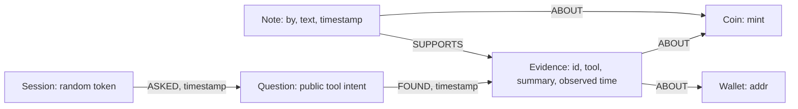
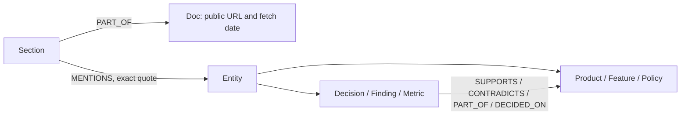

# The `lineage` graph (Day 1, 2026-10-15)

Built from snapshot `20261014T1845Z` (public on-chain and market data recorded by the QuantBase collector, which existed before the event).

| | count |
|---|---|
| Coin | 632,339 (pump.fun launches only; 276,606 other rows dropped) |
| Wallet | 424,007 |
| Hub | 89 (funders of more than 200 wallets) |
| Handle | 33,009 |
| Ring | 6,556 |
| CREATED / FUNDED / SNIPED / LINKS / IN_RING | 632,339 / 307,948 / 431,155 / 141,733 / 51,402 |

The bulk load takes 30 s, the transform 8 s and WCC 2.9 s. `GRAPH.MEMORY USAGE` reports 521 MB.

## Decisions
- **pump.fun only:** a mint must end in `pump` or have its create seen on the pump.fun program. Older collector rows hold other launchpads and existing tokens "reported as new". BONK was one: its record shows a fake 2026-09-20 launch.
- **Hub cut at 200 funded wallets.** Creator share can't tell an exchange from a farm here, because the funder data only covers creators' funders: the largest funder (33,747 wallets) shows 80% creators. Hubs keep their edges plus a `creator_share`, but no query walks through them, and they have no incoming FUNDED edges.
- **Snipers:** each sniper wallet gets an idf weight, `ln(coins sniped / coins this wallet sniped)`. The 603 wallets with more than 100 snipes are `kind = bot` and are ignored by shared-sniper links.
- **Handles:** lowercased; x.com URLs reduced to the handle; X communities kept as their own platform; junk, famous and generic-site stoplists applied. Handles on more than 200 coins count as platforms in `connect`.
- **Rings:** `algo.WCC` over Wallet+Coin with FUNDED+CREATED (hubs excluded), keeping components with at least 2 creators. **Check against the collector's clusters:**
  - 3,824 of the 3,900 multi-creator collector clusters fall entirely inside one ring;
  - 443 rings merge several collector clusters (the most is 669).

## Verified on FalkorDB 6.0.2 (`CALL dbms.procedures()`)
- **Procedure names:**
  - `algo.WCC`, `algo.BFS` (upper case);
  - `algo.pageRank`, `algo.labelPropagation`, `algo.betweenness`, `algo.SPpaths`, `algo.SSpaths`, `algo.HarmonicCentrality`, `algo.MSF`, `algo.maxFlow`.
- **Full-text index:** the docs' 3-argument `db.idx.fulltext.createNodeIndex('Coin','name','symbol')` is refused. Use `CREATE FULLTEXT INDEX FOR (c:Coin) ON (c.name, c.symbol)`.
- **`WITH` projections** need `AS` aliases.
- **Query timeout:** may not exceed `TIMEOUT_MAX` (15 s).
- **Bulk loader:** its default escape character `\` breaks on coin names like `\`, so pass `-x none` (DuckDB doubles quotes instead).

## Core queries (`app/queries.py`), each checked against DuckDB in `tests/test_queries.py`
1. `coin_dossier`
2. `funding_trail`
3. `siblings`
4. `shared_snipers`
5. `shared_handles`
6. `ring` (checked with a Python union-find)
7. `connect` (checked with a Python BFS)
8. `top_operators`

The expected counts are in `tests/expected_20261014T1845Z.json`.

## Rebuild
```bash
python build/transform.py <snapshot> build/out/<stamp>
rsync build/out/<stamp>/ box:/opt/lineage/build/<stamp>/
falkordb-bulk-insert lineage --enforce-schema --id-type STRING -x none -N Coin Coin.csv -N Wallet Wallet.csv -N Hub Hub.csv -N Handle Handle.csv -R CREATED CREATED.csv -R FUNDED FUNDED.csv -R SNIPED SNIPED.csv -R LINKS LINKS.csv
python -m build.indexes && python -m build.rings
```

## Agent tools (Day 2)
`app/tools.py` wraps the 8 queries plus `search_coins`, a full-text search:
`CALL db.idx.fulltext.queryNodes('Coin', $q)`, with the query cut to 4 alphanumeric words.

- **Paths:** serialized with stable node keys, never FalkorDB internal ids. Results are capped at 6,000 characters (rows are halved until they fit).
- **Counts:** FalkorDB returns `sum()` as a float, so the tools cast counts to integers.
- **`top_operators` windows:** measured from the newest launch in the graph (`max(created_at)`), not the wall clock, so the snapshot answers sensibly.
- **Base rate:** computed once per process. Snapshot 20261014T1845Z: 23,605 / 632,339 = 3.7%.

## Memory and company brain (Tracks 02 and 03)

These are separate FalkorDB graphs named `memory` and `brain`; they never write to `lineage`.
All writes use fixed parameterised Cypher, with labels and relationship types restricted to code enums.

### Memory model and recall



`app/memory.py` records every `/api/ask` investigation and MCP call. It stores the tool intent instead
of the visitor's raw question. A random 32-character token identifies the session; no identity, key,
header or network address is written. The browser receives an HttpOnly `sniff_session` cookie, and JSON,
SSE start/done events and MCP results also return `session_id`. MCP lineage tools accept that token on
follow-ups. The public token acts as a capability to read that session's public graph facts.

Before querying lineage, the tool runner looks for the same tool and exact arguments in that session's
memory. A hit replays the saved result and remaps its local E ids, retaining the original tool and
observed timestamp. Reuse never resets the one-hour freshness window. The agent also reads its session
before planning and can call `memory_recall`. Follow-ups without a mint recover the last investigated
coin. Cross-session recall traverses `Session → Question → Evidence → Coin/Wallet` and groups by tool
and summary; it returns counts and timestamps without session or question identifiers. Counts represent
anonymous sessions, not independent confirmations. No note is promoted to checked lineage evidence.

`memory_note` accepts a self-declared agent label, public text, and optional persistent evidence ids.
Each cited id must already exist and concern the same entity. The graph records `SUPPORTS` links and
labels the note unverified. Another agent can read Sniff's evidence and add its own observation over
the same MCP endpoint. This records coordination and provenance, not authenticated agent identity.

Range indexes cover `Session.sid`, `Question.qid`, `Evidence.eid`, `Evidence.call_key`, `Evidence.at`,
`Coin.mint`, `Wallet.addr` and `Note.nid`. Stored evidence ids are stable UUIDs; `[E#]` ids remain local
to an answer. A failed or privacy-refused memory write is explicitly reported in the response.

### Company knowledge, extraction and citations

The exact local allowlist is `README.md`, `docs/GRAPH.md`, `docs/EVAL.md`, `docs/BLOG.md` and
`docs/PUBLIC-POLICIES.md`. The builder fetches the public homepage's paper/live, safety, pricing and FAQ
sections plus allowlisted public docs. It does not follow arbitrary links, redirects, authenticated
pages, symlinks or recursive docs globs. No handover or infrastructure notes are read.

The public plans, terms and privacy articles currently contain contact email addresses, so their
**entire selected articles are refused**. Public policy summaries cite the original URLs without those
contact details. The audit records only source URL, status and refusal category. It never saves the
matched value. Both the selected raw HTML scope and its extracted text are scanned; secrets hidden in
an attribute or script also refuse that source. Local sources, extraction output and the complete
artifact are scanned again before any load. Matches include API keys, private-key encodings, wallet-key
arrays, seed phrases, emails, IPv4/IPv6 addresses, AWS ids/ARNs and credential assignments.



`python -m build.brain` uses `ai.client_for` and `ai.CHEAP[0]` (Haiku), with no expensive model fallback
or automatic retry. Default limits are 12 requests, 60,000 reserved input tokens, 12,000 maximum output
tokens and a $0.60 reservation ceiling, conservatively priced at $5 input / $25 output per million
tokens. Input reservations use UTF-8 byte counts plus framing overhead. Actual billing depends on the
provider's tariff; the request and token limits are hard limits. The output records reservations and
failed calls. Each extracted entity name and supporting quote must occur literally in its source;
relationship quotes must also contain both endpoints. Unsupported output is dropped. Unprocessed
sections retain literal source anchors and stay searchable. Each document records its extraction mode.

`--source-only` explicitly creates a corpus without AI calls and labels it accordingly. The checked-in
`build/public-brain.json` is such a privacy-scanned fallback snapshot, not a claim that a live AI
extraction happened. It contains grounded Product, Feature, Policy, Decision, Finding and Metric anchors.
Use the default builder on the demo box for capped AI extraction and richer semantic relationships.

Sections connect to their source Doc and typed Entity nodes. AI-extracted relationships retain
`source_sid` and the exact quote. Range indexes cover source and entity identifiers, active sections
and entity names; a full-text index covers `Section.text` and `Section.title`. `brain_ask` combines
indexed retrieval with bounded Cypher entity paths of zero to two semantic hops, then fetches the source
sections and neighbourhood. Answers are source excerpts, with whitespace normalised and `[B#]` ids
bound to their own section. Unknown ids, E ids, invented text and text attributed to the wrong section
fail the brain citation check. Sources retain dates and context when different public versions disagree.

The load is rerunnable: document/entity ids are deterministic, changed sections are deactivated, old
semantic relationships are removed, and current sections are upserted. The loader scans and validates
the whole artifact before its first database mutation. It does not drop existing graphs.

### Leader-only demo-box commands (not run by this task)

Run these from the release checkout after integrating `final/tracks` with `final/premium-ui`. Set
`SNIFF_HOST` and `SNIFF_SSH_KEY` to the existing demo-box SSH target and key used by `deploy/deploy.sh`.
The deployment now copies the allowlisted repo docs and the public fallback corpus as well as the app.

```bash
# LEADER: normal app deployment, with the existing host/key already configured.
./deploy/deploy.sh

# LEADER: initialise memory and perform capped AI extraction on the box's configured owner key.
ssh -i "$SNIFF_SSH_KEY" "$SNIFF_HOST" 'set -eu
  cd /opt/lineage/app/src
  export SNIFF_ENV_FILE=/opt/lineage/env/app.env
  export FALKORDB_PASSWORD_FILE=/opt/lineage/env/falkordb.env
  /opt/lineage/app/.venv/bin/python -m build.memory
  /opt/lineage/app/.venv/bin/python -m build.brain \
    --max-requests 12 --max-input-tokens 60000 --max-output-tokens 12000 --max-cost-usd 0.60 \
    --output /opt/lineage/build/brain-public.json
  /opt/lineage/app/.venv/bin/python -m build.memory \
    --mint 3LaVxn1Pp5gDjJZgGrpbQ8gRKj7GxgPE8cjF62Svpump
'
```

If the owner key is unavailable, the leader can load the reviewed source-only fallback with no API
cost or network fetch. This is a complete retrieval corpus, with its extraction limitation labelled:

```bash
ssh -i "$SNIFF_SSH_KEY" "$SNIFF_HOST" 'set -eu
  cd /opt/lineage/app/src
  export FALKORDB_PASSWORD_FILE=/opt/lineage/env/falkordb.env
  /opt/lineage/app/.venv/bin/python -m build.memory
  /opt/lineage/app/.venv/bin/python -m build.brain --load build/public-brain.json
'
```

The deployment does not require a service restart after graph loading. Check the actual public sources
and extraction modes, then try the new pages and MCP coordination tools:

```bash
curl -fsS https://sniff.quantbase.live/api/brain
curl -fsS https://sniff.quantbase.live/api/brain/ask \
  -H 'Content-Type: application/json' \
  -d '{"question":"How does QuantBase handle paper vs live?"}'
curl -fsS 'https://sniff.quantbase.live/api/memory?entity=coin:3LaVxn1Pp5gDjJZgGrpbQ8gRKj7GxgPE8cjF62Svpump'
```

Open `/brain`, `/memory` and `/memory?entity=coin:<mint>`. In any MCP client, call
`coin_dossier(mint=...)`, retain its `session_id`, and call
`memory_recall(session=...)` to get persistent evidence ids. From a second agent, call
`memory_recall(entity="coin:<mint>")`, then
`memory_note(entity="coin:<mint>", by="quantbase-trading-agent", text="Reviewed public launch history.", evidence_ids=[...])`.
The resulting note and its source evidence links appear in the coin's memory view. No fabricated
findings or synthetic notes are preloaded on the demo box.

### Local verification without demo-box access

Docker, if installed:

```bash
docker run --rm -d --name sniff-falkor -p 6379:6379 falkordb/falkordb:6.0.2
python -m build.memory
python -m build.brain --source-only --prepare-only --output build/out/brain-public.json
python -m build.brain --load build/out/brain-public.json
```

Alternatively, the leader can open the existing SSH access and provide a password file for a local
tunnel. No tunnel or SSH access was requested or used by this task:

```bash
ssh -N -L 16379:localhost:6379 -i "$SNIFF_SSH_KEY" "$SNIFF_HOST"
# In another shell, after the leader supplies the local password file:
export FALKORDB_PORT=16379 FALKORDB_PASSWORD_FILE=.falkordb.pw
python -m build.memory
```

This task used real embedded FalkorDB locally, requiring neither Docker nor remote access:

```bash
uv venv --python 3.12 .venv
uv pip install --python .venv/bin/python -r requirements-dev.txt falkordblite==0.10.0
.venv/bin/python -m pytest tests
```

`tests/test_tracks.py` uses no network or AI calls. `tests/test_tracks_falkor.py` runs the writes,
indexes, Cypher paths, session replay, anonymisation, two-agent MCP coordination, loader reruns, privacy
refusal and citation contract against isolated embedded graphs; it skips when the optional embedded
package is absent. Existing snapshot/DuckDB checks still require their original build CSVs and lineage
graph. Never point the isolated track tests at production.
